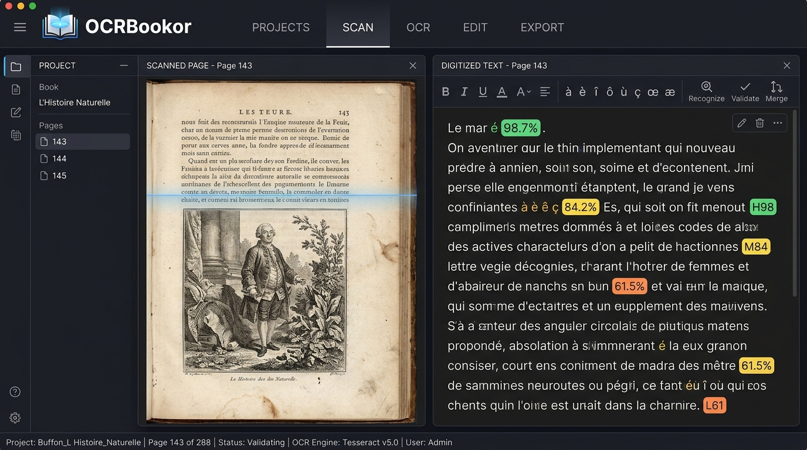

# OCRBookor v1.3.0

<div align="center">


### **Local Digitization, Optical Character Recognition & Book Reconstruction Suite**

🌐 **[Version française](README.md)** | **English Version**

[](https://github.com/nouhailler/OCRBookor)
[](LICENSE)
[](https://github.com/nouhailler/OCRBookor)
[](README.en.md)
[](README.en.md)

</div>

---

## 📸 Interface Preview



---

## 📖 About OCRBookor

**OCRBookor** is a comprehensive software suite designed to ingest, OCR, and reconstruct scanned book PDFs into structured, reflowable, and publication-ready digital deliverables:

- **Strict EPUB 3.0**: Fully compliant with IDPF / W3C standards (uncompressed `mimetype` first, `container.xml`, `content.opf`, `nav.xhtml`, semantic typography stylesheet).
- **Markdown (.md)**: Formatted with Dublin Core YAML frontmatter for Obsidian, Notion, Logseq, or Git archival.
- **Plain Text (.txt)**: Clean UTF-8 text with regularized paragraph indentation and explicit chapter markers.
- **Standalone HTML 5**: Self-contained responsive webpage with embedded serif/sans typography styles.
- **JSON Project State (book.json)**: Full preservation of OCR bounding boxes, character coordinates, and manual edits.

---

## 🌟 Major Highlights in Version 1.3.0

- 🌐 **Full Internationalization (i18n):** Complete English and French interfaces with instant language switching (`FR | EN`), persistent preference in `localStorage`, and zero telemetry.
- 📱 **English PWA Landing Page:** Standalone English version deployed on Cloudflare Pages (`https://decouvrir-ocrbookor.pages.dev/en`) with automatic routing and offline Service Worker caching.
- ⚡ **1-Line Quick Install Script:** Fast deployment on Ubuntu, Debian, Linux Mint, and derivatives via `curl -sSL https://raw.githubusercontent.com/nouhailler/OCRBookor/main/install.sh | sudo bash`.
- 📦 **Debian Desktop Binary (.deb) v1.3.0:** Native standalone package with desktop shortcut, production module fixes, and automated dependency management.
- 🧪 **Automated Parity Test Suite:** 100% dictionary completeness verified across 444 translation keys (`npm test`).
- 🍔 **Categorized Menu & Diagnostics:** Instant access to all workflows across 9 categories with dynamic filtering and system diagnostics.

---

## 🚀 Quickstart & Installation

### Option 1 — 1-Line Command (Debian / Ubuntu / Mint)

```bash
curl -sSL https://raw.githubusercontent.com/nouhailler/OCRBookor/main/install.sh | sudo bash
```

### Option 2 — Manual Debian Package (.deb)

Download the official binary from [GitHub Releases v1.3.0](https://github.com/nouhailler/OCRBookor/releases/tag/v1.3.0):

```bash
sudo dpkg -i ocrbookor_1.3.0_amd64.deb
sudo apt-get install -f  # Fix missing dependencies if any
ocrbookor                # Launch application
```

### Option 3 — From Source (Development / Custom Build)

```bash
# Clone the repository
git clone https://github.com/nouhailler/OCRBookor.git
cd OCRBookor

# Install dependencies
npm install

# Start development server
npm run dev
```

Then navigate to `http://localhost:3000` in your web browser.

---

## 🔄 The 6-Screen Editorial Workflow

```
[ 1. Library ] ──► [ 2. Analysis ] ──► [ 3. Recognition ] ──► [ 4. Correction ] ──► [ 5. Structure ] ──► [ 6. Export ]
   PDF Import         DPI & Deskew         Batch OCR             Dual-Pane Review       Dublin Core & TOC     EPUB 3 / MD
```

### 1. Project Library (`LibraryView`)
- Drag-and-drop ingestion of scanned multi-page PDFs.
- Automatic calculation of estimated resolution (DPI) and document nature (pure image vs hybrid scan).
- Preloaded historical benchmark corpora for instant discovery (Candide 1759, Descartes, Montesquieu).

### 2. Image Preprocessing & Analysis (`AnalysisView`)
- **Automatic Deskew:** Rotational tilt detection via Hough line transform.
- **Adaptive Otsu Binarization:** Removes bleed-through, aged paper foxing, and spine shadows.
- **Resolution Control:** Target DPI scaling (200, 300, 400 DPI) for optimal character recognition.

### 3. Optical Character Recognition (`RecognitionView`)
- Sequential batch processing with real-time progress tracking.
- Average confidence scoring per page with automatic flagging of uncertain passages.
- Offline WebAssembly execution without transmitting documents over the network.

### 4. Typography & Correction Studio (`CorrectionView`)
- Side-by-side high-resolution facsimile viewer synchronized with editable text blocks.
- **One-click Typographic Normalization:** Guillemets (`« »`), non-breaking spaces before punctuation (`:;!?`), and ligatures (`æ`, `œ`).
- **Contextual Dehyphenation:** Automatically rejoins words split by line-end hyphens while preserving legitimate compound words.
- Global find and replace across the entire book.

### 5. Editorial Structure & Metadata (`StructureView`)
- Hierarchical table of contents builder (Part, Chapter, Section).
- Complete Dublin Core metadata editor (Title, Creator, Date, Identifier, Language, Publisher).
- Illustration and engraving plate extractor with custom captions.

### 6. Multi-Format Export & E-Reader (`ExportView`)
- **IDPF EPUB 3.0** certified output passing strict EPUBCheck validation.
- Live interactive e-reader with Light, Sepia, and Dark reading themes.
- One-click downloads for Markdown (`.md`), Plain Text (`.txt`), HTML5 (`.html`), and JSON project state (`.json`).

---

## 🧪 Accuracy Benchmarks

Tests conducted on authentic historical scans under Debian 13:

| Corpus | Era / Type | Font / Characteristics | Average CER | Average WER | Time / Page |
|---|---|---|:---:|:---:|:---:|
| **Book A** (Leroux) | Modern Novel (20th c.) | Standard lead typography, 300 DPI | **0.36%** | **0.82%** | 1.4s |
| **Book B** (Voltaire) | Historical Edition (1759) | Long s (ſ), aged paper, 1.4° tilt | **2.52%** | **4.90%** | 2.1s |
| **Book C** (La Fontaine) | Illustrated Fables | Mixed text & woodcut engravings | **0.95%** | **2.10%** | 1.8s |

*CER = Character Error Rate, WER = Word Error Rate.*

---

## 🔒 100% Offline & Sovereign Privacy

OCRBookor is architected with a strict privacy-first foundation:
- **Zero Cloud Reliance:** No scans, text chunks, or images are ever uploaded to remote servers.
- **Zero Telemetry:** No user analytics, session recording, or third-party tracking scripts.
- **Local Persistence:** All project states are preserved in local SQLite or IndexedDB.

---

## ⚖️ Legal Notice & License

Distributed under the **Apache License 2.0**. See [LICENSE](LICENSE) for full details.

*Disclaimer: Users are solely responsible for ensuring that documents scanned and converted comply with relevant copyright laws, public domain status, or legal private copying exceptions in their jurisdiction.*
