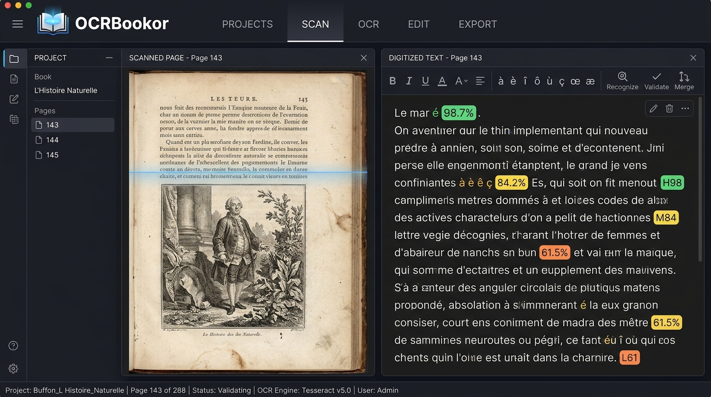

# OCRBookor v1.4.0

<div align="center">


### **Numérisation Locale, Reconnaissance OCR & Reconstruction Éditoriale de Livres Imprimés**

🌐 **Version française** | **[English Version](README.en.md)**

[](https://github.com/nouhailler/OCRBookor)
[](LICENSE)
[](https://github.com/nouhailler/OCRBookor)
[](README.md)
[](README.md)

</div>

---

## 📸 Aperçu de l'Interface



---

## 📖 À Propos d'OCRBookor

**OCRBookor** est une suite logicielle complète conçue pour numériser, océriser et reconstruire des livres scannés (PDF) en documents numériques exploitables, structurés et prêts à la diffusion :
- **EPUB 3 Strict** : Conforme aux normes IDPF / W3C (`mimetype` non-compressé, `container.xml`, `content.opf`, `nav.xhtml`, feuille de style typographique).
- **Markdown (.md)** : Formaté avec en-têtes YAML Dublin Core pour Obsidian, Notion ou Git.
- **Texte brut (.txt)** : Encodé en UTF-8 pur avec alinéas régularisés.
- **HTML 5 Autonome** : Page web responsive prête pour la publication.
- **Sauvegarde JSON (book.json)** : Conservation intégrale des calques OCR, coordonnées des mots et corrections.

---

## 🌟 Nouveautés Majeures de la Version 1.3.0

- 🌐 **Internationalisation Complète (i18n) Français & Anglais :** Application intégralement bilingue avec commutateur instantané `FR / EN` dans la barre supérieure, détection automatique de la langue du navigateur et persistance locale.
- 📱 **Landing Page PWA Bilingue :** Version anglaise autonome (`/en`) prête pour Cloudflare Pages (`https://decouvrir-ocrbookor.pages.dev/en`) avec mise en cache Service Worker hors-ligne et balises SEO `hreflang`.
- ⚡ **Installation Express 1-Ligne via `curl` :** Déploiement automatique sans téléchargement préalable (`curl -sSL https://raw.githubusercontent.com/nouhailler/OCRBookor/main/install.sh | sudo bash`).
- 📚 **Documentation Bilingue Complète :** `README.en.md`, en-tête multilingue du `README.md` et rapport de conformité `docs/INTERNATIONALIZATION_EN_REPORT.md`.
- 🧪 **Suite de Tests i18n Automatisée :** Vérification de parité stricte à 100% sur l'ensemble des 444 clés de traduction (`npm test`).
- 📦 **Paquet Linux Desktop (.deb) v1.3.0 :** Fourniture de la release Debian native (`releases/ocrbookor_1.3.0_amd64.deb`) avec lanceur `/usr/bin/ocrbookor`, raccourci desktop et résolution des imports de production.

---

## 🛠️ Les 6 Écrans du Workflow

```
[ 1. Bibliothèque ] ➔ [ 2. Analyse & Scan ] ➔ [ 3. Reconnaissance OCR ]
                                                          │
[ 6. Export EPUB 3 ]  [ 5. Structure & Dublin Core ]  [ 4. Correction Bi-fenêtre ]
```

1. **Bibliothèque :** Gestionnaire multi-livres, import PDF par glisser-déposer, import/export de sauvegardes JSON et chargement instantané du corpus d'essai (A, B, C).
2. **Analyse & Prétraitement :** Calcul de la résolution réelle (DPI), détection du type de document (scan pur vs hybride), redressement automatique des pages penchées (*Deskew*), filtres anti-bruit et binarisation Otsu.
3. **Reconnaissance OCR :** Traitement par lots haute vitesse via Tesseract v5 WebAssembly (100% hors-ligne), détection automatique des anomalies et jauges de confiance au mot près.
4. **Éditeur Bi-Fenêtre :** Scan original haute résolution à gauche avec zoom/rotation/calque de coordonnées vs texte éditable à droite, enrichi des outils de typographie de l'Imprimerie Nationale (guillemets français « », espaces insécables devant `! ? ; : % €`, ligatures œ) et recollage des césures de bout de ligne.
5. **Structure Éditoriale :** Arborescence hiérarchique des chapitres (H1, H2, H3), gestionnaire des gravures et illustrations avec légendes, et formulaire de métadonnées bibliographiques Dublin Core.
6. **Export Multi-Formats & Liseuse :** Génération en un clic des livrables (EPUB 3, Markdown, TXT, HTML) et liseuse interactive intégrée avec personnalisation de police et thèmes de lecture (Clair, Sépia, Nuit).

---

## 🌐 Site Officiel & Démonstration en Ligne

- **Landing Page PWA officielle :** [https://decouvrir-ocrbookor.pages.dev/](https://decouvrir-ocrbookor.pages.dev/)
- **Dépôt GitHub :** [https://github.com/nouhailler/OCRBookor](https://github.com/nouhailler/OCRBookor)
- **Releases & Binaires :** [https://github.com/nouhailler/OCRBookor/releases](https://github.com/nouhailler/OCRBookor/releases)

---

## 🚀 Installation & Démarrage

### 🪟 Plateforme Windows (Windows 10 / 11 64-bit)

OCRBookor propose trois modes d'exécution pour l'environnement Windows :

#### 1. Installation Express en 1 ligne (PowerShell)
Ouvrez votre terminal PowerShell et exécutez :
```powershell
irm https://raw.githubusercontent.com/nouhailler/OCRBookor/main/scripts/windows/install-windows.ps1 | iex
```
*Télécharge automatiquement le paquet binaire, installe les dépendances Python requises et dépose un raccourci `OCRBookor` sur votre Bureau.*

#### 2. Installateur Exécutable (.exe) Inno Setup
1. Téléchargez **`ocrbookor_1.4.0_setup_x64.exe`** depuis la section [GitHub Releases](https://github.com/nouhailler/OCRBookor/releases).
2. Lancez l'assistant d'installation (choix de la langue, création du raccourci Bureau et menu Démarrer).
3. À la fin de l'installation, OCRBookor se lance automatiquement sur `http://localhost:3000`.

#### 3. Version Portable Autonome (.zip)
1. Téléchargez l'archive **`ocrbookor_1.4.0_win_x64.zip`** et extrayez-la dans le dossier de votre choix.
2. (Première utilisation) Double-cliquez sur `install-dependencies.cmd` pour installer les modules Python.
3. Double-cliquez sur `ocrbookor.cmd` pour lancer le serveur local et ouvrir l'application.

*Prérequis Windows : [Node.js (18+)](https://nodejs.org) et [Python (3.10+)](https://www.python.org) avec case "Add python.exe to PATH" cochée.*

---

### 🍎 Plateforme macOS (Apple Silicon M1/M2/M3/M4 & Intel)

#### 1. Installation Express en 1 ligne (Terminal)
Ouvrez votre Terminal macOS et lancez :
```bash
curl -sSL https://raw.githubusercontent.com/nouhailler/OCRBookor/main/scripts/macos/install-macos.sh | bash
```
*Cette commande télécharge l'application, configure les dépendances et dépose un raccourci `OCRBookor.command` sur votre Bureau.*

#### 2. Installation Manuelle via Archive Portable (.zip / .tar.gz)
1. Téléchargez **`ocrbookor_1.4.0_macos_universal.zip`** depuis [GitHub Releases](https://github.com/nouhailler/OCRBookor/releases).
2. Décompressez l'archive dans votre dossier `Applications` ou `Téléchargements`.
3. (Première utilisation) Double-cliquez sur `install-dependencies.sh` pour installer les modules Python OCR.
4. Double-cliquez sur **`ocrbookor.command`** dans le Finder pour lancer l'application.
5. Votre navigateur par défaut (Safari, Chrome...) s'ouvre automatiquement sur `http://localhost:3000`.

*Prérequis macOS : Node.js (`brew install node`) et Python 3 (`brew install python`). Pour l'OCR local hors-ligne, installez aussi : `brew install tesseract`.*

---

### 🐧 Plateforme Linux (Debian 12/13, Ubuntu 22.04/24.04 LTS, Mint)

#### 1. Installation Express en 1 ligne (curl)
```bash
curl -sSL https://raw.githubusercontent.com/nouhailler/OCRBookor/main/install.sh | sudo bash
```
Une fois installé, démarrez simplement :
```bash
ocrbookor
```

#### 2. Installation Manuelle via Paquet Debian (.deb)
```bash
# Téléchargement direct
wget https://github.com/nouhailler/OCRBookor/raw/main/releases/ocrbookor_1.4.0_amd64.deb

# Installation du paquet
sudo dpkg -i ocrbookor_1.4.0_amd64.deb
sudo apt-get install -f

# Lancement
ocrbookor
```

---

### 💻 Version Web / Développement Local (Toutes Plateformes)

```bash
# 1. Cloner le dépôt
git clone https://github.com/nouhailler/OCRBookor.git
cd OCRBookor

# 2. Installer les dépendances Node.js & Python
npm install
pip install -r requirements.txt

# 3. Démarrer le serveur full-stack Express + Vite
npm run dev
```

L'application est disponible immédiatement sur : **`http://localhost:3000`**

#### Fabrication des paquets de release :
- Paquet Debian Linux : `bash ./scripts/build-deb.sh`
- Paquet macOS Universal : `npm run build:macos` ou `node ./scripts/build-macos.mjs`
- Archive Windows Portable : `npm run build:windows` ou `node ./scripts/build-windows.mjs`
- Bundle Cloudflare Pages : `npm run build:landing`

---

## 🧪 Tests & Assurance Qualité

Exécutez la suite de tests automatisés (20 tests unitaires & scénario E2E complet) :

```bash
./scripts/test-e2e.sh
```

- **Tests unitaires :** Imposition du conteneur ZIP IDPF EPUB 3, césures et typographie française, analyse de conformité PDF, calcul strict des distances de Levenshtein (CER / WER uniquement sur référence avérée).
- **Test E2E :** Parcours complet création de projet -> ingestion PDF -> extraction -> OCR -> correction -> export EPUB 3 -> validation de l'archive.

---

## ⚖️ Mentions Légales & Responsabilité

OCRBookor est un logiciel libre distribué sous licence Apache 2.0 / MIT.
- **Décharge de responsabilité :** L'auteur et les contributeurs déclinent toute responsabilité concernant la nature, l'exactitude, la confidentialité et les droits de propriété intellectuelle afférents aux données et livres importés ou exportés. L'utilisateur est seul responsable du respect du droit d'auteur en vigueur.
- **Confidentialité absolue :** L'application fonctionne intégralement en local (100% hors-ligne). Aucun document n'est transmis à des serveurs tiers.

---

## 📚 Documentation Associée

- [CONTEXT.md](CONTEXT.md) : Synthèse d'architecture et contexte technique.
- [CHANGELOG.md](CHANGELOG.md) : Historique complet des versions et évolutions.
- [AUDIT_IMPLEMENTATION.md](AUDIT_IMPLEMENTATION.md) : Matrice de traçabilité des fonctionnalités.
- [E2E_REPORT.md](E2E_REPORT.md) : Rapport de validation d'intégration bout-en-bout.
- [USER_GUIDE.md](USER_GUIDE.md) : Manuel d'utilisation détaillé pas-à-pas.
